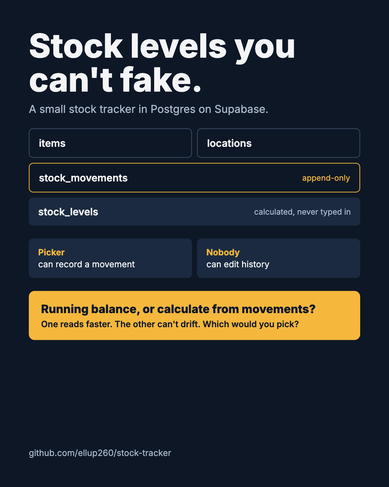

# Stock Tracker

A small stock tracker built in Postgres on Supabase. Stock levels are calculated from a log of movements, never typed in by hand, and nobody can edit history once a movement is recorded.



## How it works

| Table / view | Purpose |
|---|---|
| `items` | What is stocked (SKU, name, unit) |
| `locations` | Where it is stored (e.g. `A-01-02`) |
| `profiles` | Role for each signed-in user: `picker` or `supervisor` |
| `stock_movements` | Every change to stock. Positive quantity = in, negative = out. Append-only |
| `stock_levels` (view) | On-hand quantity per item and location, summed from movements |

Movement types: `receive`, `pick`, `adjust`, `transfer_in`, `transfer_out`.

## Access rules

- Any signed-in user can read items, locations and movements.
- A picker can record a movement as themselves, but only a supervisor can record an `adjust`.
- Only supervisors can add or change items and locations.
- Nobody can update or delete a movement. This is enforced three ways: no row-level security policy allows it, the privileges are revoked, and a trigger blocks it. To correct a mistake, record a reversing movement.

## Design decision: balance vs movements

Should the system store a running balance, or calculate it from movements every time? A stored balance reads faster, while calculating from movements can't drift out of sync.

Current choice: calculate from movements, so the numbers can be trusted. If reads get slow, the next step is a balance table kept up to date by a trigger, with a check that compares it against the movements.

## Run it

1. Create a free project at [supabase.com](https://supabase.com).
2. Open **SQL Editor** and paste in the contents of `stock_tracker.sql`.
3. Click **Run**.
4. Check it worked:

```sql
select * from stock_levels order by sku;
```

Expected on-hand quantities from the sample data:

| SKU | On hand |
|---|---|
| BLT-M8-50 | 145 |
| GLV-L-12 | 46 |
| TAP-48-CLR | 120 |
| LBL-4X6 | 34 |

## Files

- `stock_tracker.sql` – schema, access rules and sample data
- `diagram.png` – table diagram from the Supabase Schema Visualizer

## Roadmap

- Block picks that would take stock below zero
- Stock transfers recorded as paired movements
- Simple front end for pickers
